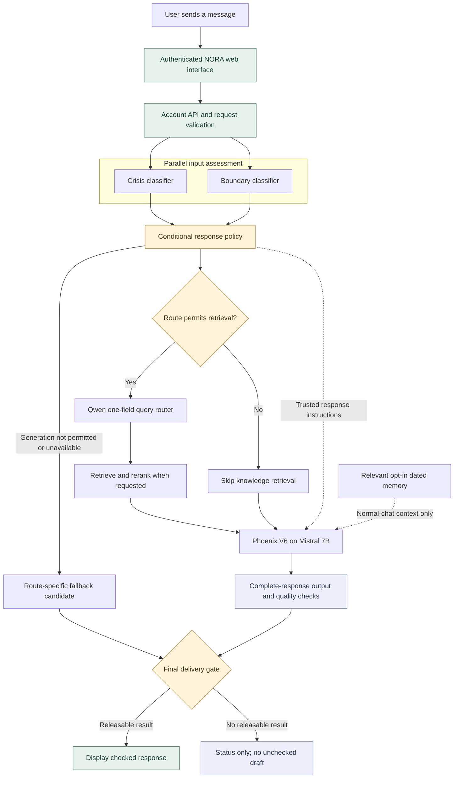

<div align="center">


# NORA

### A little room to be you.

**A Layered Safety Architecture for Mental-Health Conversational Agents**

A calm web experience. Context-aware conversations. Multiple safety checks.

[](https://github.com/emanmostafa2002723/A-Layered-Safety-Architecture-for-Mental-Health-Conversational-Agents/actions/workflows/nora-source-checks.yml)

**Graduation project · English-speaking adults · Private testing candidate**

[Explore the system](#how-nora-works) · [Run NORA](#getting-started) · [Research folders](research/README.md) · [Review the evidence](#testing-and-evidence) · [Browse the code](nora/src/mental_health_pipeline/)

</div>

---

> **For reviewers:** This repository contains the connected website and current pipeline source—not a hosted live demo. Start with the [architecture](#how-nora-works), [selected components](#models-and-components), and [verification report](nora/docs/SOURCE_EXPORT_VERIFICATION.md). The runnable application is inside **[nora/](nora/)**.
>
> **Source-only by design:** Model weights, private knowledge assets, local environments, account databases and encryption keys are excluded. Running inference requires the matching assets and [server setup](nora/docs/SERVER_SETUP.md); installing Python packages alone does not restore them.

## On this page

- [Why NORA](#why-nora)
- [The experience](#the-experience)
- [How NORA works](#how-nora-works)
- [Models and components](#models-and-components)
- [Memory and privacy](#memory-and-privacy)
- [Getting started](#getting-started)
- [Testing and evidence](#testing-and-evidence)
- [Research and reproducibility](#research-and-reproducibility)
- [Project map](#project-map)
- [Documentation library](#documentation-library)
- [Current status and limitations](#current-status-and-limitations)
- [Attribution and responsible sharing](#attribution-and-responsible-sharing)

## Why NORA

A supportive chatbot needs more than a friendly prompt. It needs to distinguish everyday conversation from risk, respect clinical boundaries, retrieve appropriate information, and examine its own answer before showing it.

NORA explores that problem through an integrated system:

1. **Understand the incoming message.** Separate crisis and boundary classifiers assess the original user text in parallel.
2. **Choose appropriate guidance.** A response-policy layer turns their outputs into route-specific permissions and instructions.
3. **Ground the conversation when useful.** RAG supplies relevant knowledge; optional, user-controlled memory supplies a small amount of personal context.
4. **Check before displaying.** Generated responses pass output and delivery checks. An unchecked draft is not streamed to the user.

The goal is a more thoughtful conversation experience with explicit safety boundaries—not a replacement for a clinician or a guarantee that models cannot make mistakes.

## The experience

NORA pairs the pipeline with a gentle, lightweight interface: warm colours, character avatars, reduced-motion options and controls that make privacy choices visible.

<div align="center">


<p><em>Character artwork used by the avatar picker—not a screenshot of the application.</em></p>

</div>

| Feature | What is implemented | Explore |
| --- | --- | --- |
| **Connected chat** | Signed-in, multi-turn conversations using the guarded pipeline rather than preview replies | [Web client](nora/src/mental_health_pipeline/web_nora/connection.js) · [Account API](nora/src/mental_health_pipeline/account_api.py) |
| **Your own space** | Display name, six character choices, avatar colours/accessories and saved interface preferences | [Preferences](nora/src/mental_health_pipeline/account_preferences.py) |
| **Comfort controls** | Text size, day/evening appearance, quiet mode and reduced motion | [Interface](nora/src/mental_health_pipeline/web_nora/index.html) · [Styles](nora/src/mental_health_pipeline/web_nora/styles.css) |
| **Optional continuity** | Separate opt-in switches for personal memory and saved chat history | [Memory selection](nora/src/mental_health_pipeline/personal_memory.py) · [Account storage](nora/src/mental_health_pipeline/account_store.py) |
| **Small pauses** | Breathing, grounding, relaxation and reflection activities | [Local interface behaviour](nora/src/mental_health_pipeline/web_nora/app.js) |
| **Resource exploration** | Topic-related imagery and selected external reading/video links; videos open on request | [Asset and content credits](nora/docs/ASSET_CREDITS.md) |
| **Data controls** | View/forget saved notes, delete chats, export account data and delete an account | [Account contracts](nora/tests/test_account_memory.py) |
| **Developer testing** | Gradio component console, CLI checks and diagnostic outputs | [Gradio](nora/src/mental_health_pipeline/gradio_app.py) · [Launcher](nora/run.py) |

Mood check-ins and reflection activities are interface features, not diagnostic instruments. Their text is not currently sent to the AI or saved as personal memory. Resource links and illustrations are not evidence of clinical review or third-party endorsement.

## How NORA works

### The message lifecycle



This is the selected baseline, not a claim that every request visits every box. An exact saved-note recall can use database-backed text without free generation; it still requires input assessment and output approval. A router decision can skip document retrieval even when the route permits it.

**What runs in parallel?** Crisis and boundary assessment. In the shipped configuration, route-permitted RAG follows policy selection, generation follows context preparation, and complete-response checking follows generation. Speculative retrieval and incremental-output experiments remain in source but are not enabled by this setup.

### Labels change the response—not just a badge

The policy layer translates classifier results into permissions, prohibited behaviours, response guidance and resource-display decisions. The generator receives short general instructions plus only the relevant conditional guidance.

| Situation | Intended system behaviour | Relevant implementation |
| --- | --- | --- |
| Ordinary greeting or routine support | Normal conversation; no detailed crisis checklist or automatic emergency block | [Conditional prompt rendering](nora/src/mental_health_pipeline/response_policy/render.py) |
| General mental-health knowledge question | Route-compatible RAG can prepare a search query and supply retrieved context | [RAG integration](nora/src/mental_health_pipeline/phoenix.py) |
| Personalized diagnosis or medication-change request | Apply clinical-boundary restrictions; do not supply a personalized diagnosis or dosing change | [Boundary policy](nora/src/mental_health_pipeline/boundary_policy.py) |
| Crisis-related message | Use the assessed tier/category and contextual evidence to choose safety-focused guidance; resources are conditional, not prepended to every answer | [Policy builder](nora/src/mental_health_pipeline/response_policy/builder.py) · [Contact display](nora/src/mental_health_pipeline/contact_display.py) |
| Repeated or unresponsive generated answer | Quality checks can request a bounded rewrite or select a fallback instead of blindly displaying the draft | [Conversation quality](nora/src/mental_health_pipeline/conversation_quality.py) |
| Missing safety component or rejected candidate | Follow the applicable fail-closed path; never expose the rejected draft as an approved answer | [Orchestrator](nora/src/mental_health_pipeline/orchestrator.py) · [Final output integration](nora/src/mental_health_pipeline/output_integration.py) |

These describe policy intent and implementation—not perfect classifier accuracy. A conversation-level crisis-count annotation does not, by itself, make all future turns crisis responses. Recent bounded safety context and current-turn policy are separate concerns.

### Two Qwen jobs, two different responsibilities

- **Before retrieval:** a one-field router prepares a search query or indicates that retrieval is unnecessary. This does not replace the original message supplied to the input classifiers or generator.
- **After generation:** a separate output-judge task inspects the complete candidate in its policy/evidence context. Its prompt and checks are distinct from RAG routing.

The selected runtime uses the same pinned `qwen3:4b` model family for these tasks; that does not mean a RAG prompt is used to approve output. See the [router adapter](nora/src/mental_health_pipeline/minicpm_router.py), [output judge](nora/src/mental_health_pipeline/local_output.py), and [output settings](nora/config/local_output_guard.json). Some adapter filenames retain earlier experiment names; the active configuration selects **`qwen_one_field`** and **`local_qwen`**, not MiniCPM or output DeBERTa.

## Models and components

| Layer | Selected component | Configuration or code |
| --- | --- | --- |
| Crisis input guard | Fresh full-encoder **epoch-3** checkpoint, paired calibration and presence-gated decoding | [Fresh crisis adapter](nora/src/mental_health_pipeline/fresh_crisis.py) |
| Boundary input guard | Selected final calibrated input-boundary release | [Boundary source](nora/components/boundary/) · [Worker](nora/src/mental_health_pipeline/workers/boundary_final.py) |
| Response policy | Versioned policy packets, route resolution and conditional generation guidance | [Response-policy package](nora/src/mental_health_pipeline/response_policy/) · [Schemas](nora/src/mental_health_pipeline/schemas.py) |
| Query preparation | **Qwen3 4B**, pinned Ollama identity, one-field prompt | [Router construction](nora/src/mental_health_pipeline/minicpm_router.py) · [Selected prompt](nora/rag_project/upstream/minicpm_2026-10-20/v2/scripts/minicpm_joint_router_prompt_v1.txt) |
| Knowledge retrieval | Sparse/dense retrieval, **all-MiniLM-L6-v2** embeddings and **bge-reranker-large** | [Retriever](nora/rag_project/scripts/retriever_v8.py) · [RAG service](nora/src/mental_health_pipeline/rag.py) |
| Main generation | **Mistral-7B-Instruct-v0.3 + Phoenix V6 LoRA** | [Generation runtime](nora/src/mental_health_pipeline/generation.py) |
| Output inspection | Complete-response **Qwen** checks, lightweight rules, policy/quality checks and final gate | [Qwen output backend](nora/src/mental_health_pipeline/qwen_only_output.py) · [Output checks](nora/src/mental_health_pipeline/output_guard.py) |
| Application layer | FastAPI, owner-scoped account service, encrypted-content SQLite and plain HTML/CSS/JavaScript | [Account API](nora/src/mental_health_pipeline/account_api.py) · [Connected web assets](nora/src/mental_health_pipeline/web_nora/) |

**Upstream model references:** [Mistral](https://huggingface.co/mistralai/Mistral-7B-Instruct-v0.3) · [Qwen3-4B](https://huggingface.co/Qwen/Qwen3-4B) · [MiniLM](https://huggingface.co/sentence-transformers/all-MiniLM-L6-v2) · [BGE reranker](https://huggingface.co/BAAI/bge-reranker-large).

These model cards describe upstream models, not NORA's private trained artifacts. Use the [runtime asset inventory](nora/config/runtime_assets.json) for the exact required files, sizes and SHA-256 checksums. Do not silently substitute older Phoenix, crisis or boundary releases. The selected crisis weights require their paired calibration and decoding adapter—not just a changed checkpoint path.

## Memory and privacy

Personal memory and saved transcripts are **separate, optional features**, both **OFF by default**.

| Kind of context | What it contains | Retention and control |
| --- | --- | --- |
| Active chat context | Bounded recent conversation in RAM | Short-lived within-chat context; not equivalent to saved history |
| Opt-in personal memory | A small set of dated, explicit reports about sleep, stress or a listening preference | At most three topic notes; maximum 30 days after an explicit update; view/forget controls |
| Opt-in saved history | Separately saved conversation content | Separate maximum 30-day retention; chat deletion controls |
| Account preferences | Alias/profile and interface choices | Separate account lifecycle; not covered by the memory-note expiry |

**How a note is made:** the current implementation uses conservative deterministic extraction—not an LLM that stores arbitrary personal information. For example, an accepted explicit sleep report can become a dated note such as “reported difficulty sleeping.” It does not become a diagnosis or a full biography. Relevant notes can be recalled across chats for the same authenticated owner; they are lower-trust context, not safety instructions.

Implementation details: [note extraction and selection](nora/src/mental_health_pipeline/personal_memory.py), [owner-scoped storage](nora/src/mental_health_pipeline/account_store.py), [account service](nora/src/mental_health_pipeline/account_service.py), and [isolation tests](nora/tests/test_account_hardening.py).

- Passwords are salted and hashed. Notes, saved transcripts and interface preferences are encrypted at rest; basic IDs, aliases and timestamps remain metadata.
- Forgetting a note does not also delete the same words from a separately saved transcript. Both controls are available.
- Database files and the separate encryption key stay out of Git. Never share `.runtime/private-accounts/` as part of a source submission.
- Account export and deletion are implemented, but this is still a private, single-process identity prototype—not a complete production identity or compliance platform.

## Getting started

### 1. Review the source without loading models

```bash
git clone https://github.com/emanmostafa2002723/A-Layered-Safety-Architecture-for-Mental-Health-Conversational-Agents.git nora-current
cd nora-current/nora
python scripts/audit_source.py
```

The repository is private: use your own authenticated GitHub access. Choose a new destination directory; do not clone over an existing installation. The source audit checks reviewed file hashes and accidental inclusion patterns; it is not a comprehensive security or license review.

### 2. Restore the exact runtime assets

Follow the **[server migration guide](nora/docs/SERVER_SETUP.md)** before attempting inference. You need Python **3.12**, compatible ML dependencies, the selected model/corpus assets and a matching Ollama model.

For a new server checkout, the asset workflow is:

```bash
# Run from nora/. First copy the template and edit the local mappings.
cp config/server-assets.example.json config/server-assets.local.json

# Read-only verification; missing mappings or mismatched files must be resolved.
python scripts/link_server_assets.py --sources config/server-assets.local.json --check

# Run only after every required asset verifies.
python scripts/link_server_assets.py --sources config/server-assets.local.json --apply
```

The linker creates project-local **hard links** to checksum-matching files on the same filesystem; it does not import an older application's code, overwrite mismatched targets or silently copy multi-GB weights. Linked paths share the underlying file: do not edit model weights in place. Keep the old installation until the new one is verified.

Useful files: [required assets](nora/config/runtime_assets.json) · [mapping template](nora/config/server-assets.example.json) · [classifier-only packaging helper](nora/scripts/pack_classifier_assets.py).

### 3. Prepare the environment and check readiness

```bash
# Python 3.12; creates a new project-local environment, without installing packages.
bash setup_linux.sh
.venv-api/bin/python scripts/check_dependencies.py
.venv-api/bin/python -m pip check

# New checkout only: copy the configuration example, then review it.
cp config/server-assets.env.example .env.server
ollama list
.venv-api/bin/python run.py qwen-check
.venv-api/bin/python run.py preflight
.venv-api/bin/python run.py rag-check
.venv-api/bin/python run.py smoke --message 'Hi'
```

Inspect missing dependencies and available disk space before installing anything; the [server guide](nora/docs/SERVER_SETUP.md#3-environment-inspect-before-installing) describes the deliberate installation step. Do not overwrite an existing `.env.server` or bypass a failed asset/readiness check.

`qwen-check` verifies the selected router's prompt/model identity **without inference**. `rag-check` exercises retrieval; `smoke` runs a complete guarded turn. A development-mode readiness result can still contain release warnings—read them.

### 4. Open the private interface

```bash
.venv-api/bin/python run.py web
```

Open **http://127.0.0.1:7861** using an authenticated VS Code/SSH port forward. Create a synthetic test account, review the adult/language scope and privacy controls, then try a normal chat and a separate memory-recall test. Stop with **Ctrl+C**.

For the component-testing console, use this **instead of** a second simultaneous model UI:

```bash
.venv-api/bin/python run.py gradio
```

The Gradio console defaults to **http://127.0.0.1:7860**. Keep both interfaces private. A GitHub source link is not a public application endpoint, and no hosted demo is provided by this repository.

<details>
<summary><strong>GPU placement and latency notes</strong></summary>

The supplied configuration reflects the tested small-GPU environment: Phoenix uses CUDA/4-bit settings, while Qwen, input guards and retrieval are configured for CPU operation. Uploading the folder to a larger GPU server does not automatically move those components onto the GPU.

Review both [environment settings](nora/config/server-assets.env.example) and [Qwen output settings](nora/config/local_output_guard.json) together before server benchmarking. Avoid several model processes competing for memory. Do not remove the output gate to obtain a faster demo.

In a small local HTTP smoke set, account/API handling added approximately **0.03–0.28 seconds** beyond pipeline processing; loading, generation and Qwen checks dominated the delay. These are not server benchmarks, browser-rendering measurements or production latency guarantees. See the [detailed latency evidence](nora/docs/NORA_WEB_INTEGRATION_VERIFICATION_2026-10-20.md).

</details>

## Testing and evidence

| Evidence | Recorded result | What it does—and does not—show |
| --- | --- | --- |
| Source-only local regression | **392 passed, 3 skipped** | Software contracts; three actual-corpus probes skip because the private corpus is excluded |
| GitHub Linux / Python 3.12 CI | **182 passed**, plus the **217-file source integrity check** | Account, interface, policy, resource and asset-linking contracts; no learned models are loaded |
| Full development regression | **711 passed, 2 skipped** | Historical local development evidence, not the current source-only CI suite |
| Connected real-model HTTP smoke | Four documented functional cases, including cross-chat recall and a medication boundary | Small synthetic local smoke set—not clinical validation, a broad accuracy study or a university-server benchmark |

**Read the evidence:** [source-export verification](nora/docs/SOURCE_EXPORT_VERIFICATION.md) · [connected-pipeline and timing report](nora/docs/NORA_WEB_INTEGRATION_VERIFICATION_2026-10-20.md) · [latest GitHub runs](https://github.com/emanmostafa2002723/A-Layered-Safety-Architecture-for-Mental-Health-Conversational-Agents/actions/workflows/nora-source-checks.yml) · [CI workflow](.github/workflows/nora-source-checks.yml).

The suites are different scopes and must not be added together as independent experiments. The source checks do not demonstrate clinical effectiveness or eliminate classifier/output-judge errors. Browser visual/accessibility review and server inference acceptance remain necessary.

### Reproduce the source-only CI checks

Use a separate Python 3.12 test environment, from **`nora/`**:

```bash
python3.12 -m venv .venv-tests
.venv-tests/bin/python -m pip install -e '.[test]' numpy
.venv-tests/bin/python scripts/audit_source.py
PYTHONPATH=src .venv-tests/bin/python -m pytest -q \
  tests/test_account_memory.py tests/test_account_hardening.py \
  tests/test_account_live_http.py tests/test_account_ui_contracts.py \
  tests/test_nora_integration.py tests/test_schemas.py \
  tests/test_response_policy_builder.py tests/test_response_policy_situation_codes.py \
  tests/test_session_store.py tests/test_resources.py tests/test_server_assets.py
```

These commands install software test dependencies, not model weights. After restoring runtime assets, use `python scripts/audit_source.py --allow-runtime-assets` for source checks and the asset linker for model checksums.

## Research and reproducibility

The runnable application lives in **[nora/](nora/)**. Component experiments belong in the separate **[research/](research/README.md)** area, so reviewers can follow the experiment story without confusing an older trial with the selected runtime.

There are dedicated folders for [crisis](research/crisis_classifier/), [input boundary](research/boundary_guardrail/), [RAG](research/rag/), [Phoenix generation](research/generation/), [output guardrails](research/output_guardrail/), [response policy](research/response_policy/), [integration](research/system_integration/), [personal memory/accounts](research/personal_memory/) and [web UI](research/web_interface/).

Each component has an upload map and relevant folders for preparation, code/configs, notebooks, evaluation, data documentation and results. Owners should document baseline → changes → evidence → selected/rejected outcome using the supplied templates.

**Current status: structure only.** The research folders are ready for team uploads; no historical experiments or datasets were copied or approved by creating them. Uploading a research candidate does not automatically change the application.

- **Team members:** follow the [upload instructions](CONTRIBUTING.md) and [research PR template](.github/PULL_REQUEST_TEMPLATE/research_upload.md).
- **Experiment authors:** complete an [experiment card](research/templates/EXPERIMENT_CARD.md) and [run manifest](research/templates/run_manifest.example.json).
- **Dataset authors:** follow the [synthetic-data sharing review](research/DATA_SHARING.md), [dataset card](research/templates/DATASET_CARD.md) and [manifest example](research/templates/dataset_manifest.example.json). Synthetic status alone is not permission to publish.

## Project map

```text
.
├── README.md                         Submission overview and navigation
├── CONTRIBUTING.md                   Team research-upload and review instructions
├── .github/workflows/                Active source-only Linux CI
├── research/                         Component experiment stories; awaiting team uploads
│   ├── README.md                     Component index and reproduction conventions
│   ├── DATA_SHARING.md               Synthetic/source-data publication checklist
│   ├── templates/                    Experiment cards and dataset/run manifests
│   └── <component>/                  Relevant code folders, data guide and results guide
└── nora/                             Run application commands here
    ├── src/mental_health_pipeline/
    │   ├── orchestrator.py           Complete guarded turn lifecycle
    │   ├── response_policy/          Label-conditional instructions and contracts
    │   ├── account_*.py              Accounts, isolation and user preferences
    │   ├── personal_memory.py        Conservative dated-note extraction/recall
    │   ├── workers/                  Component worker adapters
    │   └── web_nora/                 Connected HTML, CSS, JavaScript and artwork
    ├── components/                   Required boundary and output/rule source
    ├── rag_project/                  Retrieval code and versioned routing prompts
    ├── config/                       Templates and source/model checksum inventories
    ├── scripts/                      Launching, auditing and verified asset linking
    ├── tests/                        Synthetic software and interface contracts
    ├── docs/                         Setup, verification, privacy limits and credits
    ├── pyproject.toml                Python package metadata and dependency extras
    └── run.py                        Web, Gradio and diagnostic entry point
```

Runtime model folders are intentionally absent from this tree. Compatibility/experiment modules may remain as imports, but their presence does not make them selected backends. Use the [active configuration example](nora/config/server-assets.env.example), not filenames alone, to identify the selected system.

## Documentation library

| Looking for… | Go here |
| --- | --- |
| Application-specific overview | [NORA application README](nora/README.md) |
| Component experiments and team uploads | [Research index](research/README.md) · [Contribution guide](CONTRIBUTING.md) |
| Synthetic-data sharing and reproducibility records | [Sharing checklist](research/DATA_SHARING.md) · [Dataset card](research/templates/DATASET_CARD.md) · [Experiment card](research/templates/EXPERIMENT_CARD.md) |
| Server setup and reuse of existing weights | [Server migration guide](nora/docs/SERVER_SETUP.md) |
| Exact model/corpus files and checksums | [Runtime asset inventory](nora/config/runtime_assets.json) · [Pipeline artifact manifest](nora/config/artifacts.json) |
| Configuration templates | [Environment example](nora/config/server-assets.env.example) · [Server asset mapping](nora/config/server-assets.example.json) · [Output judge settings](nora/config/local_output_guard.json) |
| Source provenance and verification limits | [Source-export verification](nora/docs/SOURCE_EXPORT_VERIFICATION.md) · [Reviewed source inventory](nora/config/source_files.json) |
| Connected website implementation | [Frontend](nora/src/mental_health_pipeline/web_nora/) · [Account endpoints](nora/src/mental_health_pipeline/account_api.py) |
| Timing observations and real-model smoke details | [Connected integration report](nora/docs/NORA_WEB_INTEGRATION_VERIFICATION_2026-10-20.md) |
| Software dependencies | [Package and extras](nora/pyproject.toml) · [Observed server versions](nora/requirements/server-observed.txt) |
| Image/model/source attribution | [Third-party notices](nora/THIRD_PARTY_NOTICES.md) · [Image credits](nora/docs/ASSET_CREDITS.md) · [Artwork provenance](nora/docs/ART_PROMPTS.md) |
| Tracked changes and automation | [Commit history](https://github.com/emanmostafa2002723/A-Layered-Safety-Architecture-for-Mental-Health-Conversational-Agents/commits/main/) · [Pull requests](https://github.com/emanmostafa2002723/A-Layered-Safety-Architecture-for-Mental-Health-Conversational-Agents/pulls) · [Actions](https://github.com/emanmostafa2002723/A-Layered-Safety-Architecture-for-Mental-Health-Conversational-Agents/actions) |

## Current status and limitations

**Included:** connected NORA website, accounts and user controls, the selected component integrations, conditional response policy, optional memory, asset verification tools and source-level tests.

**Required separately:** trained weights, matching knowledge assets, compatible ML dependencies, the pinned Ollama model, and verification on the target machine. The university server has not been migrated merely by updating this repository.

**Not claimed or completed by this submission:**

- Public clinical deployment approval or proven clinical effectiveness.
- Perfect crisis detection, factual grounding, output screening or conversational quality.
- Production HTTPS, password recovery, independent security/privacy assessment or a production identity service.
- A supplied production transcription component; transcription is currently disabled.
- A browser-based visual/accessibility acceptance test or a new representative server benchmark.
- Clinical authorization of the resource catalogue or permission to redistribute every external dataset/model/artwork.

NORA is an **AI wellbeing companion**, not a human therapist, diagnostic service or emergency service. Keep testing private, use synthetic accounts, inspect release warnings and retain the complete output gate. Passing software tests is an engineering result—not permission to use the system as clinical care.

## Attribution and responsible sharing

This project integrates upstream model families, component source and visual assets. Their individual licenses and permissions still apply. No project-wide open-source license is inferred from access to this private repository; review the [third-party notices](nora/THIRD_PARTY_NOTICES.md), [asset credits](nora/docs/ASSET_CREDITS.md), and upstream model cards before redistribution.

For final submission, share this repository link and ensure assessors have access while it remains private. Do not commit model weights, personal conversations, `.env.server`, local asset mappings, database files or encryption keys.

---

<div align="center">

**NORA · A little room to be you.**

Built to explore thoughtful conversations and layered safety—not to replace human care.

[Back to top](#nora) · [Application guide](nora/README.md) · [Server setup](nora/docs/SERVER_SETUP.md) · [Verification](nora/docs/SOURCE_EXPORT_VERIFICATION.md)

</div>
