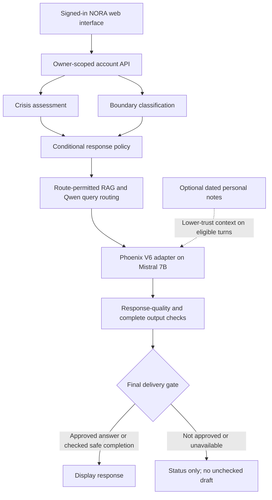

<div align="center">

# NORA
### A little room to be you.


**A mental-wellbeing companion with a layered safety architecture.**

Calm conversations · Retrieval-augmented support · User-controlled memory

**Graduation project · English-speaking adults · Private testing**

</div>

---

> **Source-only repository.** The website and latest integration code are included. Model weights and knowledge assets are restored separately from verified server files; no trained checkpoint is downloaded by installing Python requirements.

## Meet NORA

NORA combines a gentle web experience with a structured mental-health conversation pipeline. Its interface offers a space to talk, optional grounding activities, a small resource library, customizable avatars and clear controls over what is remembered.

Behind the interface, separate components assess the incoming message, select applicable response guidance, retrieve relevant material, generate a reply and inspect the complete response before it can be displayed.

NORA is an **AI companion, not a human therapist, diagnostic service or emergency service**. Technical integration and passing software tests do not establish clinical effectiveness or authorize public clinical deployment.

## What you can do

| Experience | What it provides |
| --- | --- |
| **Talk at your pace** | Multi-turn conversations through the full guarded pipeline |
| **Make it your space** | Optional display name, six character avatars, colours and accessories |
| **Choose what stays** | Independent opt-in personal memory and saved-chat controls |
| **Take a small pause** | Optional breathing, grounding, relaxation and reflection activities |
| **Explore resources** | Topic-related imagery, external reading and on-demand video links |
| **Stay in control** | View/forget notes, delete chats, export data and delete your account |
| **Make it comfortable** | Text-size controls, day/evening appearance, quiet mode and reduced motion |

## How a message travels



The two input guardrails run in parallel. Downstream actions depend on the selected route: restricted routes can skip retrieval, and an exact personal-memory recall can avoid free generation. This is a conceptual baseline, not a claim that every request invokes every box. Speculative RAG and incremental output experiments are not enabled by this diagram.

Detailed guidance is conditional on the relevant labels. An ordinary greeting does not receive a detailed crisis checklist. Crisis-count annotations do not convert every later message into a crisis response. Generated tokens are **not streamed to the user before approval**.

## Selected components

| Responsibility | Current selection |
| --- | --- |
| Incoming crisis assessment | Fresh full-encoder epoch-3 checkpoint with its paired calibration and presence-gated decoding |
| Incoming boundary assessment | Selected final calibrated input-boundary release |
| RAG routing/query preparation | Qwen3 4B with the one-field router prompt |
| Retrieval | Processed knowledge corpus, hybrid retrieval, semantic embeddings and reranking |
| Main generation | Mistral-7B-Instruct-v0.3 with the Phoenix V6 LoRA adapter |
| Response instructions | Short general instructions plus label-conditional policy guidance |
| Output checking | Qwen-based complete-response checks, lightweight rules and final delivery gate |
| Account storage | SQLite with encrypted notes, saved transcripts and interface preferences |
| Interfaces | Connected NORA web UI; Gradio/Jupyter for component testing |

The trained output DeBERTa and MiniCPM experiments are **not** the selected output backend. Transcription is currently disabled because its production component has not been supplied.

## Code here. Model assets elsewhere.

This repository is intended to contain **application source, the website, required component code, prompts, configuration examples, dependency files, tests and documentation**.

It must not contain model checkpoints, LoRA weights, downloaded model stores, private knowledge corpora, vector-index binaries, virtual environments, account databases, encryption keys, caches or raw conversation logs.

The models are still required to run NORA. Leaving them out of GitHub does not make them optional, and installing Python requirements does not restore trained checkpoints. A deployment must provide the exact assets and match the documented versions/hashes.

### Assets required on the runtime machine

- Mistral-7B-Instruct-v0.3 base weights, configuration and tokenizer.
- Phoenix **V6** adapter weights and adapter configuration, not the older V3 or V5 adapter.
- Fresh crisis **epoch-3** weights, paired `calibration.json`, matching architecture/configuration and tokenizer. Neither ST01c alone nor S600 is a substitute for this selected release.
- The selected boundary checkpoint, its base/tokenizer files, release configuration and calibration.
- The matching processed RAG corpus and document metadata, sparse/dense indexes and embedding configuration.
- `all-MiniLM-L6-v2` embedding and `bge-reranker-large` reranker assets selected by the runtime configuration.
- The expected `qwen3:4b` Ollama model and the separate routing/output prompts and settings.

Server source folders are mapped in a private JSON file. The supplied linker checks every required file's SHA-256 before creating project-local hard links. This preserves the pipeline's path checks, avoids large duplicate copies, and never imports the old server's application code. See [server setup](docs/SERVER_SETUP.md).

## Getting started

This is a source-only project: Python **3.12**, matching model assets and a working pinned **qwen3:4b** Ollama service are required. A clone is not immediately inference-ready.

In the team repository, this application lives under **`nora/`**.
Enter that folder before running the commands below; no external application
submodule is required.

```bash
# In the new server checkout, after restoring/verifying assets:
bash setup_linux.sh
.venv-api/bin/python scripts/check_dependencies.py
cp config/server-assets.env.example .env.server
.venv-api/bin/python run.py qwen-check
.venv-api/bin/python run.py preflight
.venv-api/bin/python run.py web
```

The setup creates a project-local environment with system packages visible; it does not download models or install packages blindly. Review dependency availability before installing missing requirements.

Open **http://127.0.0.1:7861** through an authenticated VS Code/SSH port forward. Stop other model UIs first. The server remains loopback-only; this is not public deployment.

- [Step-by-step server setup](docs/SERVER_SETUP.md)
- [Required asset identities](config/runtime_assets.json)
- [Candidate server asset mapping](config/server-assets.example.json)
- [Image and thumbnail credits](docs/ASSET_CREDITS.md)
- [Source export verification](docs/SOURCE_EXPORT_VERIFICATION.md)

### Project layout

```text
src/mental_health_pipeline/   Latest orchestration, account API and connected NORA UI
components/                  Input-boundary and reused output/rule source code
rag_project/                 Runtime retrieval scripts and routing prompts (no corpus)
config/                      Config templates and source/model checksum inventories
scripts/                     Source audit, dependency checks and verified asset linking
tests/                       Selected synthetic software contracts
docs/                        Setup, privacy limits, verification and attribution
run.py                       Private web, Gradio and component-check launcher
```

The original development folder is retained separately. This copy excludes training/evaluation data, private accounts, old updates and downloaded models. Some import-compatible experiment modules remain in source but are not selected runtime backends.

## Your data, your choice

- Personal memory and saved chat history start **OFF**, independently.
- Opt-in memory stores a small number of dated, explicit user reports—not diagnoses or an unrestricted biography—with a maximum **30-day** lifetime after an explicit update.
- Saved chat content has a separate maximum 30-day retention period. Account/profile settings do not share that expiry.
- Active conversations also use bounded, short-lived RAM context. Turning saved history off is not the same as disabling all within-chat context.
- Forgetting memory notes does not erase the same words from separately saved transcripts; both controls are available.
- Passwords use salted hashing. Notes, saved transcripts and interface preferences are encrypted at rest. Basic aliases, IDs and timestamps remain metadata.
- The database and its separate encryption key must **never** be committed or uploaded with a source release.
- Reflection text and mood check-ins in the current interface are not sent to the AI or stored as personal memory.

This is a private account prototype, not a production identity platform. HTTPS deployment, recovery flows, operational security and privacy review remain separate work.

## Testing and honest limits

The **source-only export** passed **392 tests**, with three real-corpus probes
explicitly skipped because the private RAG corpus is not included. Its
component-import, account-isolation, UI/API, policy and hard-link safety tests
ran locally without loading model weights. A server inference run is still
required after assets are restored. See [verification](docs/SOURCE_EXPORT_VERIFICATION.md).

The integrated development copy recorded **711 passing software tests and two environment-specific skips** on 20 October 2026. Additional synthetic HTTP tests exercised the real pipeline, profile persistence, cross-chat recall and account deletion. These are local engineering results, not a published CI result, representative clinical trial or guarantee of safety.

The website/API was not the main source of delay in the local smoke tests. HTTP and account/database handling added roughly **0.03–0.28 seconds** beyond pipeline processing. Browser rendering and internet/port-forward latency were not measured. Model loading, generation and Qwen-based checks dominate the observed wait.

The current laptop settings deliberately place Qwen on the CPU to leave its 6 GB GPU available for Phoenix. A server's GPU allocation needs separate configuration and benchmarking; moving the folder does not automatically accelerate all components.

Known limitations include possible classifier mistakes, missed output violations, false refusals, imperfect grounding, inconsistent conversational quality and slow cold starts. Do not describe passing these tests as public-deployment or clinical approval.

## Sharing and attribution

Preserve upstream model licenses, component notices, image credits and dataset permissions. This source repository retains the final website's asset credits. Access to a research dataset or trained artifact does not automatically grant permission to redistribute it publicly.

Start with a **private repository** while the team checks source/data permissions and removes private information. A project-wide open-source license should be selected with the team before public release; this source export does not grant rights over third-party models, data or artwork.

---

<div align="center">

**NORA · A little room to be you.**

Built to explore thoughtful conversations and layered safety—not to replace human care.

</div>
